# 使用手册

这份文档讲「每个按钮是干什么的、什么时候该用哪个模式」。

只是想先装上跑起来的话，看 README 的「30 秒上手」就够了，回来再查细节。

## 目录

- [一、它能做什么](#一它能做什么)
- [二、安装与第一次启动](#二安装与第一次启动)
- [三、界面总览](#三界面总览)
- [四、启动页](#四启动页)
- [五、悬浮层](#五悬浮层)
- [六、识别页](#六识别页)
- [七、题库页](#七题库页)
- [八、关于页](#八关于页)
- [九、录屏与截图的隐私保护](#九录屏与截图的隐私保护)
- [十、常见问题](#十常见问题)
- [十一、卸载与清理](#十一卸载与清理)

## 一、它能做什么

在你的安卓手机上，读屏幕上的题目，从你自己导入的题库里找答案，用悬浮层把答案显示出来。

三个关键点。

- 题库由你导入。程序不自带任何题目，装上就是空的，先去「题库」页导入。
- 默认完全离线。纯本地模式下不联网、不花钱、内容不出手机。
- 答案只显示原文。题库里答案写 `B`，界面显示「数据结构」，不会让你自己去对选项。

## 二、安装与第一次启动

安装分三步。

1. 下载 `香蕉做题.apk`，在 Release 页面下方。
2. 点击安装。系统提示「不允许安装未知来源应用」时，去允许一次：设置 → 应用 → 特殊权限 → 安装未知应用 → 选中你的浏览器或文件管理器 → 允许。
3. 装好后桌面上会出现香蕉图标。

第一次打开会先看到一屏说明，内容是三条。

- 仅供个人学习，禁止用于考试作弊。
- 题库由你自己导入，答案是否准确需要自行判断。
- 识别结果可能出错，使用后果由使用者自行承担。

点底部「我已了解，开始使用」进入主界面。之后不再出现，除非说明文字有实质改动。

进主界面后，在「启动」页的 ② 授权 卡片里逐项授权。

- **悬浮窗权限**：显示圆形按钮、工具栏、答案小窗的前提，点「去授权」后打开开关。
- **通知权限**：前台服务保活用，Android 13 及以上要单独给，点「去授权」后允许。
- **无障碍服务**：默认取词方式靠它读屏幕文字，点「去开启」，找到「香蕉做题」并打开。
- **忽略电池优化**：可选，降低后台被系统回收的概率，点「去设置」后允许。

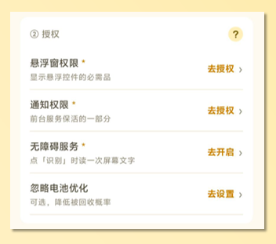

每次用 `adb install` 覆盖安装后，无障碍服务会被系统清掉，需要重新打开一次。这是系统的行为，不是程序的问题。

*（下方截图示例为 vivo 手机，不同手机开启方式可能会有差异，请自行探索）*

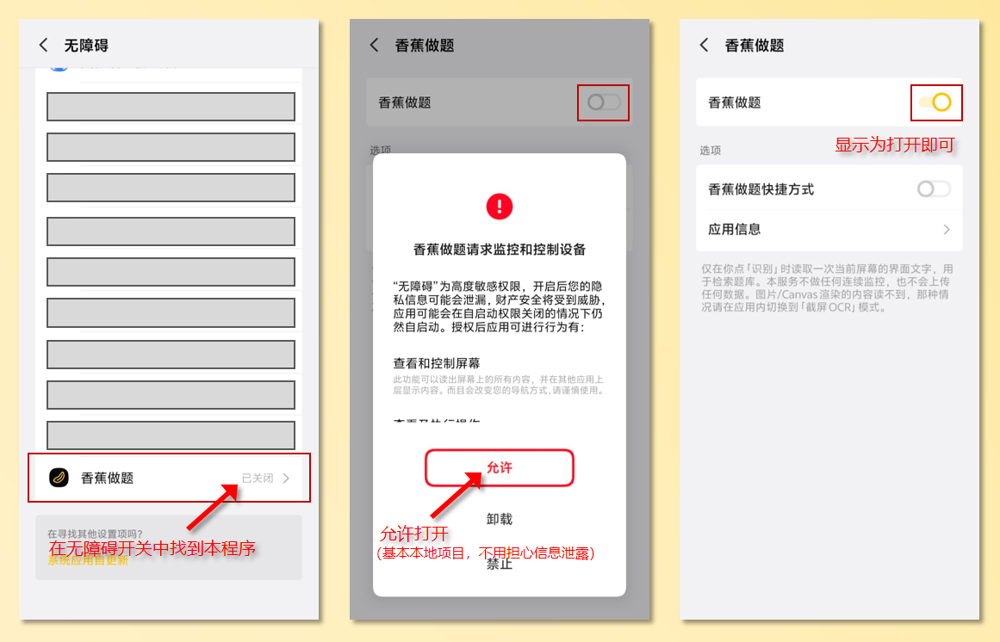

## 三、界面总览

导航在顶部，左边是标题，中间是四个标签页，右边是两个圆钮。

- 四个标签页：启动、识别、关于、题库。
- 右上角左边那个圆钮是点击音效开关，右边那个是明暗主题切换，默认跟随系统。

四个页面的分工是这样。

- **启动**：开头设一次就基本不用再来，负责取词方式、授权、搜索模式、DeepSeek 填写、启停服务。
- **识别**：调参用，负责三档阈值、离线 OCR、识别选区、结果外观、题干裁剪。
- **关于**：自检与信息，负责识别链路自检、运行日志、识别历史、隐私开关、作者与版本。
- **题库**：导入和管理题库，负责导入、批次管理、搜索、查重、导出备份。

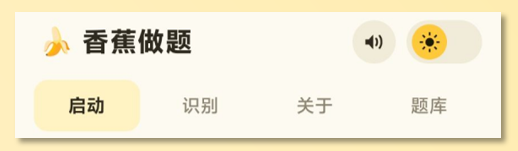

## 四、启动页

这一页的东西设好一次就够了。

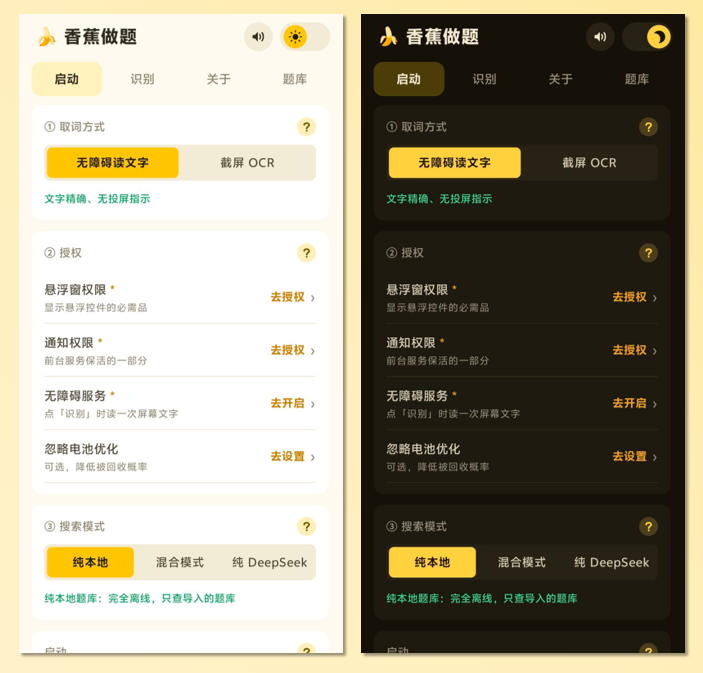

### ① 取词方式

两种方式只能选一个。

- **无障碍读文字**，默认。直接读应用给出的文字节点，不弹授权，状态栏没有投屏图标，能读到的题是毫秒级出结果，Token 也更省。
- **截屏 OCR**。截一张整屏图再做离线识别，每次启动会弹「开始录制或投放」，状态栏有投屏图标，速度慢一些，但图片题也能读。

怎么选。题目是文字，比如刷题 App、网页、PDF，就用无障碍；题目是图片，或者对方用 Canvas 直接画字，才换截屏 OCR。

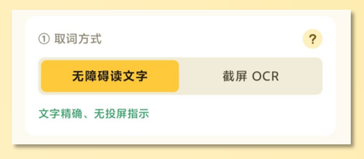

### ② 授权

见第二节，四项里前三项是必需，第四项可给可不给。

### ③ 搜索模式

三档，区别在题库和联网。

- **纯本地**：只查你导入的题库，不联网。题库够全、想零成本零联网就用这个。
- **混合模式**：题库优先，没把握才问模型。想省钱又怕题库里没有，就选这个。
- **纯 DeepSeek**：完全不查题库，每题都问模型。题库里没有的科目、临时用一下，选这个。

选「混合模式」或「纯 DeepSeek」时，下面会滑出 ④ 卡片；选「纯本地」时整张卡片收起。

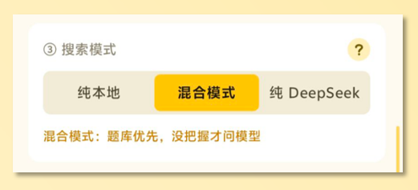

### ④ DeepSeek API 填写

只在联网档下出现，填写分四步。

1. 去 [platform.deepseek.com](https://platform.deepseek.com) 申请 API Key，形如 `sk-…`。
2. 粘贴进输入框，点「保存」。
3. 点「测试连通」验证一次，成功会提示延迟毫秒数，失败会写明 401 或超时。
4. 保存后上面会出现「已保存：`sk-…7147`」，只显示首尾几位。

四个按钮的分工。

- **保存**：加密存进系统密钥库，算法是 Android Keystore 的 AES-256-GCM。
- **测试连通**：用当前 Key 发一次最小请求，只验通路，消耗的 token 可以忽略。
- **显示 / 隐藏**：显示时把完整 Key 填进输入框，方便核对。
- **清除**：连输入框、已存 Key、上次测试结果一起清掉。

发送内容有两个选项。

- **只发文字**：发题干文字加本地最接近的 3 条候选，最省；题目是图片时，识别质量取决于读屏能不能读到字。
- **文字 + 截图**：再加一张图，单图控制在 1024 token 以内，每题多花约三分之一成本，但图能帮模型定位题干。

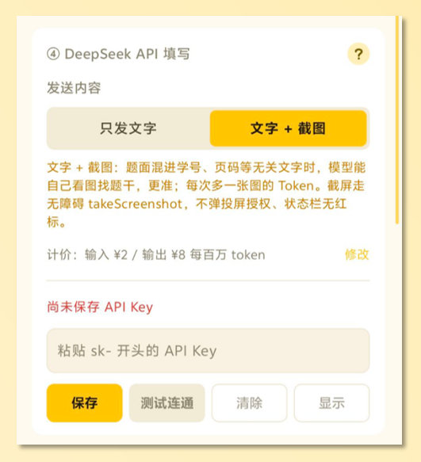

用量计价那一栏填输入和输出单价，默认是每百万 token 输入 2 元、输出 8 元。答案小窗底栏会显示这次的实际消耗，例如「耗时 8ms · 1,234 token · 约 0.0031 元」。

### 启动与停止

参数调好后点「启动」。

- 无障碍模式下，点完立刻退回桌面，屏幕右侧出现圆形按钮。
- 截屏 OCR 模式下，先弹系统投屏授权，选「共享整个屏幕」，再退回桌面。

运行中，启动页和识别页的参数会整片变淡，并挂上「服务运行中」的徽章。这是故意的，避免你改了参数却不知道有没有生效；想改参数先点「停止服务」。

## 五、悬浮层

启动之后，真正干活的是三样东西。

### 圆形按钮

启动后出现在屏幕边缘的圆点，可以拖着走，整组按钮会跟着一起移动。

- 点一下，展开工具栏。
- 拖动，换位置，位置会记住。
- 透明度在「识别」页调，默认 60%，调低能少挡内容。

### 工具栏

展开后是六个图标，从左到右依次是下面这些。

- **选区**：画一个框，只识别框里那一块。
- **全屏**：恢复整屏识别。
- **识别**：读一次屏幕，出答案。
- **显示 / 隐藏**：显示或收起答案小窗。
- **手动**：弹出输入框，自己打字查，只查题库不联网。
- **停止**：停止服务，会先弹一张确认卡，防误触。

### 答案小窗

识别完成后出现在按钮上方，从上到下是这样几块。

- 顶部是题型和候选序号，例如「候选 1 · 单选题」。候选数在识别页调。
- 中间大字是答案原文。
- 底栏是耗时、是否命中题库；走模型时还会显示 token 数与金额。
- 「复制」按钮把答案复制到剪贴板。

窗口可以拖动，内容长了可以滚动。

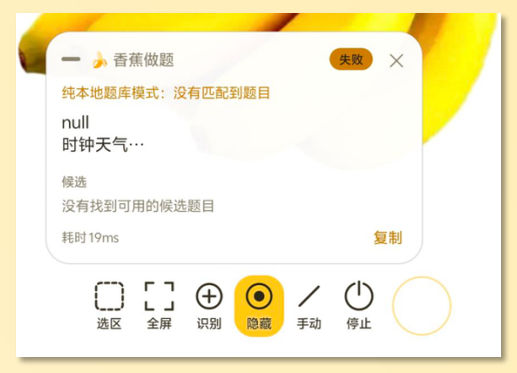

### 手动输入

点「手动」弹出一个小框，打完字回车即查，只查题库不联网。适合题目不在屏幕上，或者你想核对某道题的情况。

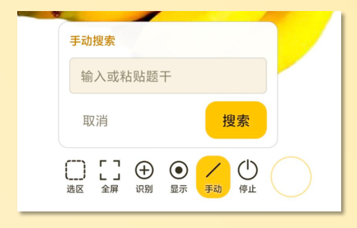

## 六、识别页

这一页全是参数，**运行中会被锁住**。

### 三档分流

只在「混合模式」下生效，三档的行为和花费不一样。

- **一档**：接近率达到阈值一，默认 85%，直接用题库答案，不花 token。
- **二档**：接近率达到阈值二，默认 60%，只把文字发给模型做对齐，花得少。
- **三档**：低于阈值二，发文字加一张截图，花得最多。选了「只发文字」时，这一档仍然只发文字，不会截图。

卡片底部有一行「按当前设置实际走法」，会把当前模式下的真实行为写清楚。

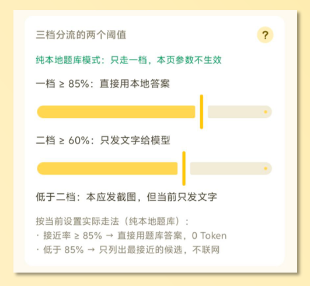

### 离线 OCR

开启后，截屏 OCR 用内置的 ML Kit 中文识别，不走网络。

### 识别选区

三个按钮的分工。

- **框选区域**：弹出选区遮罩，画一个框，框完立刻写回设置并刷新。
- **查看选区状态**：截一帧按选区裁出来显示，用来核对框的位置和实际识别区对不对得上。
- **清除选区**：恢复整屏识别。

「查看选区状态」用的是无障碍截图，不申请投屏；关闭弹窗时会立即释放位图。

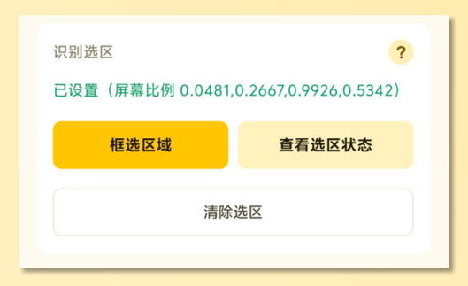

### 结果外观

四个参数。

- **展示候选数**：默认 3 条，决定答案小窗里列几条本地候选。
- **按钮透明度**：默认 94%，改的是圆形按钮和工具栏的不透明度；调低会变透明、对屏幕内容遮挡更少。
- **框体宽度**：默认 280 dp，是答案小窗的宽度。
- **框体高度**：默认 360 dp，也是答案小窗的最大高度，内容超出就在框内滚动。

### 框体预览

点「框体预览」，屏幕上会出现一个按当前宽高画的虚线空框，用来先看尺寸合不合适。

预览期间不能启动服务，点「启动」会提示先关闭框体预览。反过来，服务运行中也不能预览，会提示先停止服务。

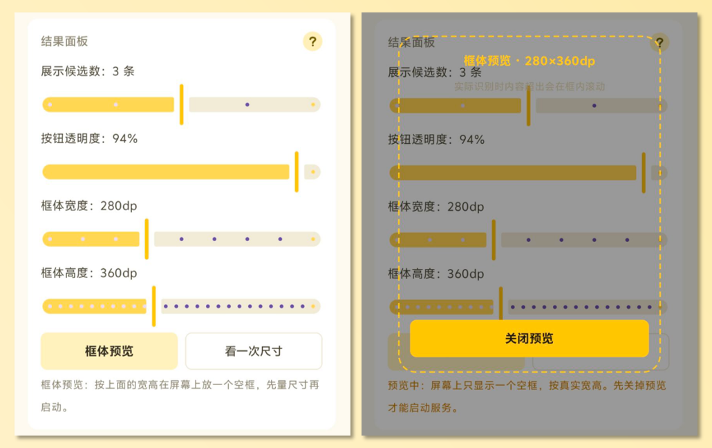

### 题干裁剪

「上边界」和「下边界」两个滑条，用来裁掉屏幕顶部和底部的干扰内容，比如状态栏、头像、输入法、推荐位。识别不准时，先把下边界调大。

## 七、题库页

导入和管理都在这一页。

### 导入题库

四种方式。

- **选择文件**：选 txt、csv、docx、xlsx、json、jsonl，可以多选，每个文件单独一批。
- **粘贴文本**：直接粘贴纯文本题库，按 txt 规范解析。
- **书写规范**：打开格式说明弹窗，也可以导出成文件慢慢看。
- **保存模板**：把 7 个模板存到手机的 `Download/香蕉做题模板/` 目录。

格式怎么写，见 [题库书写规范](题库书写规范.md)。

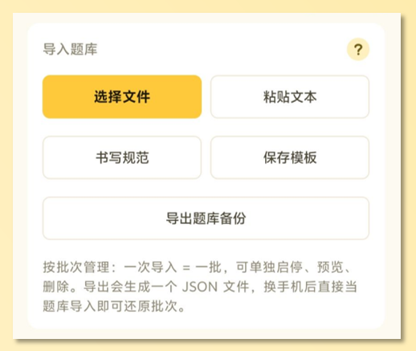

### 批次管理

一次导入等于一批。每批一行，右侧三个操作。

- **启用 / 停用**：停用的批次不参与识别匹配，数据仍然保留。
- **预览**：表格形式看这一批的题，每页 10 题，可以翻页，也可以搜索。
- **删除**：删掉这一整批，会先确认一次。

勾选多批可以批量删除。

### 预览、搜索、查重

三件事分开放。

- **批次预览**：表头固定为序号、题型、题干、答案，点某一行展开全文，翻页在底部。
- **跨批次搜索**：题库页顶部的搜索框，输入即筛，结果显示批次、题干、答案，可以单条删除。
- **查重**：按归一化题干分组，每组可以「保留最早」或「保留最新」一键清理，也可以逐条删。

### 导出备份

点「导出题库备份」会生成一个 JSON，存到 `Download/香蕉做题题库/`。里面包含所有批次和每批的停用状态，换手机后把它当题库导入就能还原。

## 八、关于页

这一页有五块内容。

- **识别链路自检**：用题库里的样例题走一遍识别流程，验证读词、匹配、显示是否正常，自带「换一道题」。
- **运行日志**：最近的应用事件，排查问题时可以复制走；正式包不写系统日志。
- **识别历史**：最近 50 次识别，包含时间、档位、题干、答案、token 与金额，可以清空。
- **隐私**：「防录制」开关，默认开。开启后截图、录屏、投屏里悬浮层会被系统涂黑。
- **关于这个程序**：作者、GitHub 主页、使用边界、开源许可、版本号。

## 九、录屏与截图的隐私保护

这一节只讲一件事：别人录屏、截图、投屏的时候，屏幕上这些浮层会变成什么。

**哪些窗口受保护**

- 悬浮条、圆形按钮、答案小窗、手动输入框、选区遮罩，以及程序自己的所有弹窗，全部带 `FLAG_SECURE`。
- 这是安卓的窗口级开关：声明之后，这些窗口不会进入任何截屏、录屏、投屏的合成结果。

**录下来是什么样**

- 录屏和系统截图里，这些窗口所在的位置是一块纯黑矩形，大小和窗口一样。
- 答案小窗是黑块，工具栏是黑块，圆钮是黑块；位置看得见，内容一个字都看不到。

**能不能换成马赛克或模糊**

不能。系统只提供「把这个窗口排除掉」这一种行为，应用无法指定用黑色、模糊还是别的什么替代。想在录屏里彻底不留痕迹，只能在录制前先停掉服务。

**程序自己截图时怎么处理**

- 「查看选区状态」和截屏 OCR 抓帧前，程序会先把所有浮层设为透明，抓完再恢复；所以这两条路径拿到的画面里既没有自己的控件，也没有黑块。
- 抓到的图像只在内存里使用，不写入文件。

**开关**

- 位置：「关于 → 隐私 → 防录制」，默认开启。
- 关掉之后录屏和截图会拍到真实内容，包括答案。除非你在做录屏演示，否则不建议关。

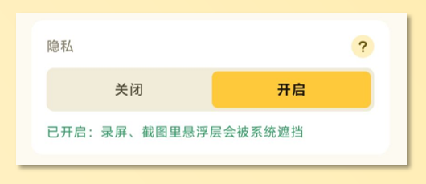

**几种特殊情况**

- 安卓 14 以上的「仅共享此应用」：系统只采集你选中的那一个应用，本来就不包含本程序的浮层。
- `adb screencap` 这类特权抓帧路径不受窗口开关约束，那属于调试手段，正常使用用不到。
- 少数定制系统会把黑块换成锁形图标或模糊，这是厂商行为，应用控制不了。

## 十、常见问题

**问：点了「识别」没反应，怎么办？**

先确认取词方式选对了，图片题用无障碍是读不到的。再看无障碍服务是否被系统清掉，覆盖安装后很常见。最后检查裁剪边界或选区有没有把题目裁到框外。

**问：出来的是「未命中」而不是答案？**

题库里确实没有这道题，可以切到混合模式问模型，或者先导入题库。也可能是题干混进了页眉页脚，用选区把范围框住，或者调上边界和下边界。

**问：DeepSeek 报 401 或提示 Key 无效？**

Key 复制时带了空格，或者已经失效。重新生成后保存，再点「测试连通」。运行中不能改 Key，先停止服务。

**问：录屏里悬浮层是黑块？**

正常，这是防录制的效果，答案和工具栏不会被录进画面。不想要可以在「关于 → 隐私」里关掉，但不建议。

**问：输入法上的题接不到？**

有些输入法把题目画在自绘面板里，无障碍读不到，换截屏 OCR。

**问：手机会不会偷偷上传我的图？**

纯本地模式完全不联网。混合模式和纯 DeepSeek 只在你允许的时机把题干文字发出去，勾了截图才多发一张图，目标是 `api.deepseek.com`，没有别的服务器。

## 十一、卸载与清理

- 题库、设置、识别历史都在应用私有目录，卸载即清空。
- 想保留题库，先「导出题库备份」。
- 「识别历史」可以单独清空；「运行日志」里的内容也可以复制走再清。
